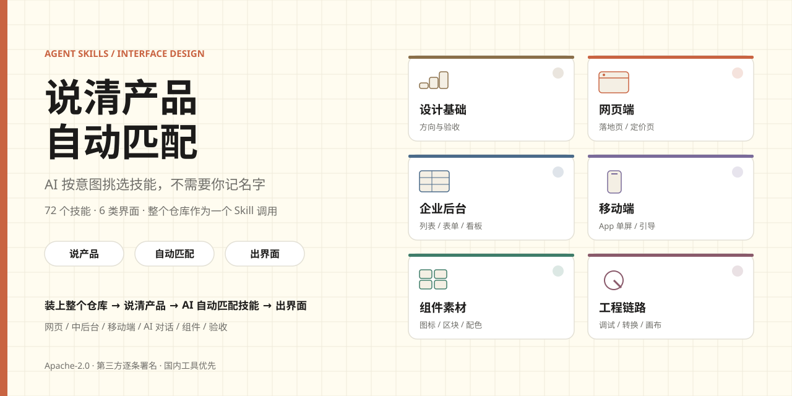
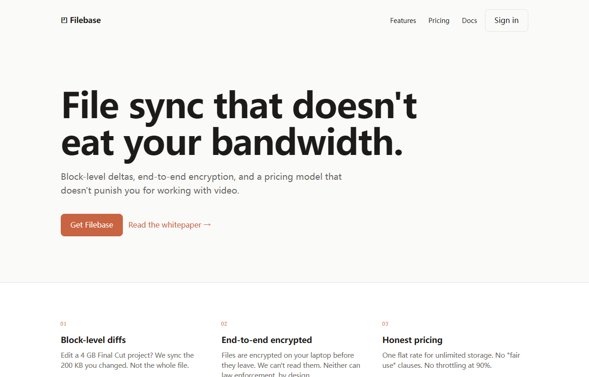
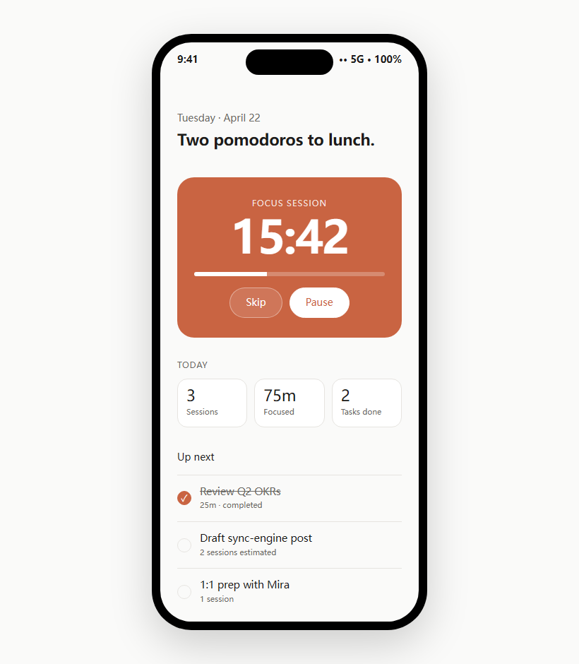
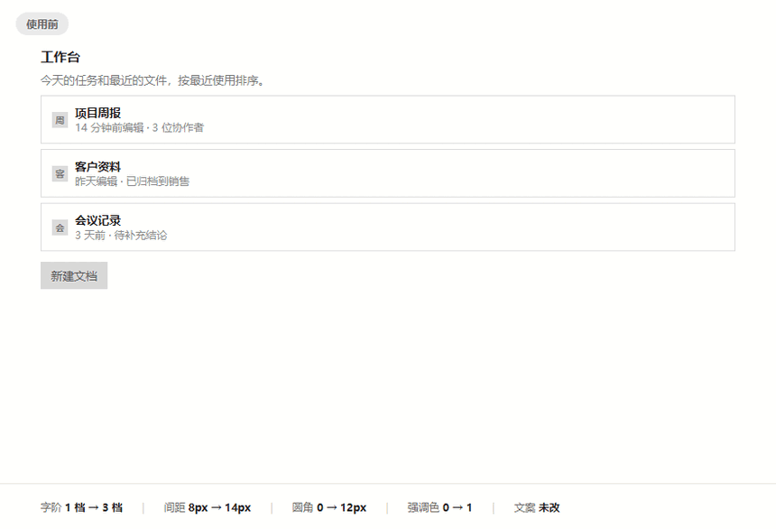
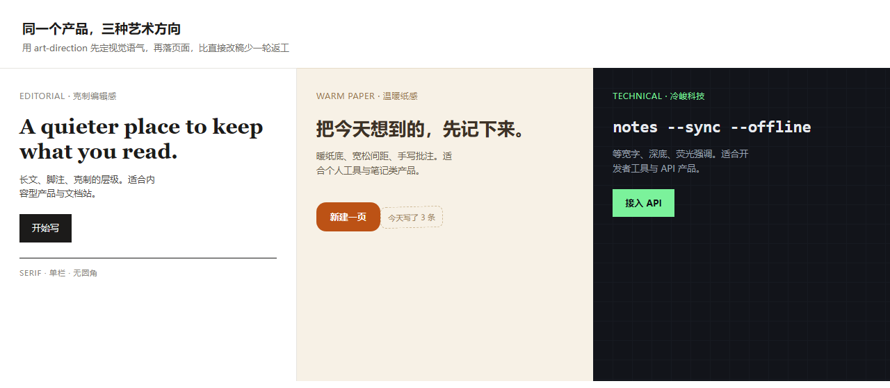
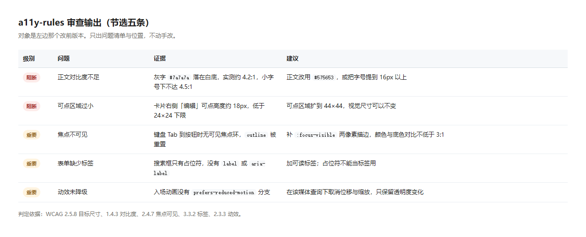
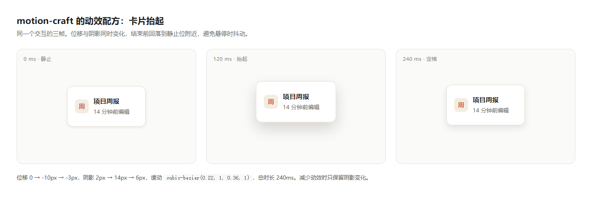

<div align="center">

# UI Design Skills

Describe the product you want. The AI matches the right skill out of 67. No directory browsing, no skill names to remember.

</div>



<div align="center">


Current release v2.3 · 72 skills · Apache-2.0

[中文](./README.md) · English · [Contribute a translation](https://github.com/YardonYan/ui-design-skills/issues)

[See it working](#see-it-working) · [30-second start](#30-second-start) · [Install](#install-and-supported-assistants) · [Describe the product](#just-describe-the-product) · [Copy-paste prompts](#copy-paste-prompts) · [Intent & fallback](#intent-routing-and-fallback) · [Integrated skills](#what-the-integrated-skills-can-do) · [Six categories](#whats-in-the-six-categories) · [FAQ](#faq)

</div>

A UI design skill repository you can call as a whole. Point your agent at the repository, say what product you are building, who it is for and roughly what it should look like. The repository handles the routing: the root `SKILL.md` recognises intent, `docs/intent-routing.md` supplies the decision rules and fallbacks, and the selected skill produces the output.

The sections below move from seeing the output, to getting started, to describing a product, to copying prompts, to understanding the fallback and the whole library. Every example can be copied as a block. None of them contains a skill name.

## See it working

All four images are real output. Under each one is what the person said, followed by the skill the repository matched. You only supply the first part; the second line is the AI's own decision.

<table>
<tr>
<td width="50%" valign="top">



Web · matched `saas-landing`

> I need a homepage for a file-sync product. Top nav, hero, three feature cards, pricing and FAQ. Desktop 1440 first, single column on mobile.

</td>
<td width="50%" valign="top">


Enterprise · matched `dashboard`

> I need an operations dashboard. Fixed left nav, top search and notifications, four KPI cards, a 30-day trend chart, an account table and a recent-events list.

</td>
</tr>
<tr>
<td width="50%" valign="top">



Mobile · matched `mobile-app`

> I'm building a focus-timer app, show me one screen inside an iPhone 15 Pro frame. Status bar, dynamic island, main timer card, today stats, a task list and a bottom tab bar.

</td>
<td width="50%" valign="top">


AI chat · matched `assistant-ui` + `ai-chat-patterns`

> I'm building an AI assistant with tool approval. Streaming output, manual stop, retry on failure, follow-up suggestions, and an approval card stating the action, its scope, whether it is reversible, with Approve and Reject side by side and a visible timeout rule.

</td>
</tr>
</table>

None of the four prompts names a skill; the repository decides which `SKILL.md` files to read. Open the matching HTML in `assets/demos/` to reproduce the images.

## 30-second start

Find your situation first:

| Your situation | Start here |
|---|---|
| Just want to see what it can do | Scroll up to See it working, or the four images in What the integrated skills can do |
| Have a task and need an interface | Jump to Just describe the product and change the product name in one sentence |
| Want it inside your project or team | See Install and supported assistants; clone once to call the whole repository |

Three steps:

1. Put the whole repository in your workspace, by cloning it or downloading a zip.
2. Tell your agent to use the repository and read the root `SKILL.md` first.
3. Describe the product. No directory browsing, no skill names.

The smallest prompt that works:

```
Use the UI Design Skills repository, read the root SKILL.md first, and match the right skill to my request.
I want to build: <one sentence describing the product and who it is for>.
Deliver a single self-contained HTML file I can open directly.
```

You can use it without installing anything: paste the root `SKILL.md` into the chat and let the agent read the matching skill files from the repository. Installing once simply removes the manual step.

## Install and supported assistants

You install the whole repository, not a single skill directory. Zero-dependency installer, Node 18 or newer:

```bash
node tools/install.mjs --list
node tools/install.mjs --skill saas-landing --ai workbuddy
node tools/install.mjs --skill all --ai workbuddy --dry-run
```

If you only want to call the repository as a whole, cloning it is enough. The installer is for placing skills into a specific assistant's directory; install only what you need. It verifies every selected skill has `SKILL.md` at its root and refuses the whole batch otherwise.

| Flag | Effect |
|---|---|
| `--list` | List every skill and category |
| `--skill <name>` / `--skill all` | Pick one skill or all |
| `--ai <id>` / `--ai all` | Install into one assistant or all configured assistants |
| `--project` | Install into the current project instead of the user-level directory |
| `--dir <path>` | Explicit target directory, overrides the default |
| `--dry-run` | Print planned copies without writing |
| `--force` | Overwrite an existing target |
| `--uninstall` | Remove skills installed from this library |

Domestic tools first (usable without a proxy in mainland China), then international tools (usually need outbound access).

| Assistant | `--ai` id | Default user-level directory |
|---|---|---|
| WorkBuddy | `workbuddy` | `~/.workbuddy/skills/` |
| CodeBuddy | `codebuddy` | `~/.codebuddy/skills/` |
| TRAE CN | `trae-cn` | `~/.trae-cn/skills/` |
| Qoder | `qoder` | `~/.qoder/skills/` |
| Qwen Code | `qwen-code` | `~/.qwen/skills/` |
| OpenClaw | `openclaw` | `~/.openclaw/skills/` |
| Claude Code | `claude` | `~/.claude/skills/` |
| Codex | `codex` | `~/.codex/skills/` |
| Cursor | `cursor` | `~/.cursor/skills/` |

These are defaults; override with `--dir`. The repository also works as a plugin-marketplace source, with four manifests at the root:

```bash
claude plugin marketplace add YardonYan/ui-design-skills
```

Browser IDEs, cloud shells and online notebooks are not applicable: they have no skill loader. To get a running interface, take the templates into your own project.

## Just describe the product

This table is a routing reference for the AI, not a multiple-choice question for you. You do not need to memorise it or put skill names in your prompt. The more naturally you describe what you want, the easier it is to match correctly.

| What you would probably say | AI usually matches | What you get |
|---|---|---|
| I need a product homepage / landing page | `saas-landing` | Hero, features, social proof, pricing, one page |
| I need a pricing page with three tiers | `pricing-page` | Monthly/annual toggle, comparison table, FAQ |
| I need a FAQ or docs site | `faq-page`, `docs-page` | Q&A page and three-column docs page |
| I'm building an admin, order system, CRM | `enterprise-admin` | Back-office page structure and field definitions |
| Turn these fields into a validated form | `admin-form-schema` | Field list, types, validation rules, sample JSON |
| I need a dashboard for our metrics | `dashboard`, `live-dashboard` | KPI grid, trend chart, activity feed |
| I'm building an app, show me one screen | `mobile-app` | A single screen inside a device frame |
| What are the iOS / Android / mini-program sizes | `mobile-design-spec` | Five platform specs and safe-area values |
| I'm building an AI assistant with approvals | `assistant-ui` | Runtime wiring, components, ready-made elements |
| What states does a chat UI have to handle | `ai-chat-patterns` | State list and a 20-item acceptance checklist |
| I need a consistent set of icons | `icon-system` | Nearly a thousand icon definitions and naming rules |
| I need illustrations / empty states | `spotkit` | Deterministic SVGs, light and dark |
| Give the product light and dark colours | `flexoki-palette` | Palette CSS and light/dark mapping |
| This looks AI-generated, fix it | `unslop` | Line-by-line critique, no full rewrite |
| Review interface and accessibility | `web-design-guidelines` | A list of compliance issues |
| Turn this mockup into code | `image-to-code` | Reconstructed page code |
| Rebuild a site like this one | `web-clone` | Section-by-section reconstruction path |
| A single-file report, or HTML to PDF | `html-skill-effectiveness`, `html-to-pdf` | Deliverable files |

Full indexes: `ROUTER.md` (by everyday phrasing), `docs/skill-map.md` (by the six stages of making an interface), and the intent-routing notes below.

## Copy-paste prompts

Every block below assumes you have already given the agent the whole repository. You describe what you want; the repository decides which `SKILL.md` to read, following `docs/intent-routing.md`. Do not put skill paths in your prompt and do not browse the directory first.

### Universal formula

```
Use the UI Design Skills repository, read the root SKILL.md, and match the right skill to my request.
I want to build: [a product / page / interface; one sentence on what it is and who it is for].
Constraints: [React / single HTML file / mobile / no external dependencies, omit if none].
Style & exclusions: [restrained / editorial / no purple gradients or glows, omit if none].
Deliver: [an openable page / a set of icons / a review checklist].
When done, tell me in one sentence which skills you matched and why.
```

### By scenario

Landing page

```
I need a homepage for a developer-facing API monitoring product. Restrained style, warm paper
background, no purple gradients or glows. Top nav, large hero, dual CTA, four feature cards,
a three-step flow, three pricing tiers, FAQ and footer. Give me a single HTML file I can open.
```

Pricing page

```
I need a three-tier pricing page for a SaaS product, with the middle tier marked as recommended.
Include a monthly/annual toggle, a full feature comparison table and FAQ. Use placeholder numbers,
do not invent real prices.
```

Enterprise admin

```
I'm building an order-management admin, start with the list page. Filters, bulk actions,
pagination, status badges and an inline-edit entry point. Use only these fields: order id,
customer, amount, status, created at. Do not add fields I did not give you.
```

Form schema

```
Turn this field set into a validated form schema: types, required flags, defaults, enum
dictionaries, validation timing and error messages. Give me sample JSON. Never invent fields
that are not in the input.
```

Mobile

```
I'm building a habit tracker, show me one screen. Put it in an iPhone frame with a status bar,
today's progress, a seven-day streak, a task list and four bottom tabs. Check safe areas and
touch targets against the platform specs.
```

AI chat interface

```
I'm building an AI assistant with tool approval. Streaming output, manual stop, retry on failure,
follow-up suggestions, and a tool-approval card stating the action, its scope, whether it is
reversible, with Approve and Reject side by side and a visible timeout rule.
```

Colour

```
Give me light and dark themes for a long-form reading site. Body text must have enough contrast,
colour is for semantics only. Deliver CSS variables; do not write a second copy of the hex values.
```

Icons

```
Make eight functional icons for a file manager: new, upload, download, share, archive, search,
delete, settings. Stroke width, corner radius and padding must match across the set, all colours
derived from one accent. Export standalone static SVGs at the end.
```

Fix an existing interface

```
This HTML looks AI-generated, critique it for me. Do not rewrite the whole page. Keep the structure,
first list the evidence with locations, then fix in passes: spacing, colour, icons, copy, type,
layout. One class per pass.
```

Review

```
Review this interface against the checklist. Report issues and their locations only, do not edit yet.
```

### More precise input, more predictable output

| You might say | Say instead | Why |
|---|---|---|
| Make a nice page | Build a developer pricing page, three tiers, restrained, warm paper | Nice has no acceptance criteria; output, tiers and style do |
| Build an admin | Build an order list page with exactly these five fields | Admin is too broad; unlisted fields appear by guesswork |
| Make it like that big product | Large headline, narrow body column, hairline borders, no gradients | Describing traits is safer than copying a specific product |
| A few icons, whatever | Eight functional icons, shared stroke and radius, one accent | Count and invariants are what make a set |
| Make it look better | Only change card spacing and heading weight in section two | Without a boundary the agent rewrites everything |
| Which skill should I use | Don't worry about it, just say what you are building | Routing is the repository's job, not yours |
| Use our internal field names | Use abstract field names; I will fill real ones locally | Keep internal data out of external services and public output |

### Follow-up prompts

```
Keep the overall structure. Change only [one property] of [one region]. Leave everything else alone.
```

```
List every choice you made and flag the ones I did not ask for.
```

```
Review the motion, report issues only, do not edit yet.
```

```
Produce a dark variant using the same palette as before.
```

## Intent routing and fallback

Vague requests, or requests spanning several categories, do not stall the repository. Two files carry the decision logic, both written for the AI to read:

| File | Responsibility |
|---|---|
| Root `SKILL.md` | Entry point for the whole repository. The agent reads it first for the four-step flow, a shortcut map, and one hard rule: never ask the user to name a skill |
| `docs/intent-routing.md` | Intent notes: four judgement dimensions, a natural-language signal table, the six-category map, conflict rules, fallback paths and anti-patterns |

Judgement uses four dimensions and stops as soon as it has enough: what the output is, what platform it lives on, what stage the work is at, and what constraints apply. Output carries the most weight, platform second.

The fallback has six fixed steps; stop at the first one that resolves:

1. If the output fits one of the six categories, use that category's primary skill.
2. If the output is unclear but the platform is clear, start with a landing page for web, an admin for back office, an app screen for mobile, or a chat interface for AI assistants.
3. If the platform is unclear but the stage is clear, use critique for fixes, the guidelines for review, or a direction skill for positioning.
4. If all four dimensions are vague, ask at most two questions: page, interface or file? Who uses it and on what device? No follow-up chains, no directory browsing.
5. If there is still nothing to go on, offer a direction draft to choose from rather than waiting.
6. If the output clearly is not an interface (Word, PDF, PPT, backend APIs, data analysis), say it is out of scope instead of forcing a skill.

Conflicts have explicit rules: create/read/update/delete and fields go to enterprise, display and conversion go to web; a whole page goes to page skills, a reusable block goes to component skills; icons plus colour means the main output picks the primary skill and colour becomes the assistant. Multi-skill work follows direction, structure, output, assets, review, with at most two supporting skills.

If the user says the match was wrong, switch skills and redo. They should not have to explain the request again.

## What the integrated skills can do

These five were adapted from other people's UI skill content and are now part of the 72 skills, installable and routable like the rest. The first four images are real output; the fifth skill produces text, so the prompt is printed instead.

### Before and after: the lift from one skill



Same copy, same structure; the GIF alternates between before and after. The still below puts both versions side by side for item-by-item comparison.


> This page feels flat. Rework it with design-vocabulary, dimension by dimension. Do not change the structure.

Four kinds of change only: type scale, spacing, corner radius, one accent colour. No copy rewritten, no block moved.

### Three art directions: settle the tone first



> I'm building an AI notes tool. Use art-direction to give me three visual directions side by side.

One product description, three tones: restrained editorial, warm paper, technical. Pick one and build from it; cheaper than rewriting a page.

### Accessibility review: a list, not a rewrite



> Review this interface with a11y-rules. List issues and locations only, do not edit yet.

The output is graded findings with evidence and a fix, citing WCAG clauses. This kind of review will not quietly rewrite your code.

### Motion recipe: one interaction in three frames



> This card hover feels stiff. Give me a recipe from motion-craft.

Offset, shadow, easing and duration are all stated, including what to keep under reduced motion.

### Motion prompt: turning an effect into reusable text

`motion-prompts` returns text. To reproduce the card lift above, this is what you hand the AI:

```
Write a reusable prompt for a card hover lift in the motion-prompts format.
Name: hover lift
Timing: 0 -> -10px -> -3px, 240ms, ease-out
Shadow: 2px -> 14px -> 6px, in step with the offset
Fallback: under prefers-reduced-motion keep only the shadow change
```

## External resources and integrated skills

The repository has 72 skills, five of them adapted from other people's UI skill content and promoted into `skills/`. Calling this one repository is enough; there is no need to hunt through other skill libraries. A nine-class resource index is available for on-demand lookup.

| Part | Path | Contents | When |
|---|---|---|---|
| Integrated skills | `skills/foundations/` | `design-vocabulary`, `art-direction`, `a11y-rules`, `motion-craft`, `motion-prompts` | Polish, art direction, accessibility, motion, prompt writing |
| Resource index | `references/resources/` | 37 repository links + 103 sites | Component libraries, inspiration galleries, colour tools, UI prompt libraries, templates |

The integrated skills are real skills with uniform names and `SKILL.md` files: installable, routable and validated. Their rule text has been adapted into each skill's `references/`. The `hallmark`, `ui-ux-pro-max`, `frontend-design` and `emil-design-eng` skills and the 84-brand DESIGN.md corpus already here are not duplicated. Attribution and licences are registered in `THIRD-PARTY.md`.

The resource index is skipped by default. When the user wants an output, go straight to a skill; only signals such as find, is there, reference or inspiration open it, and then read `references/resources/INDEX.md` plus the one matching class file. Full rules are in `docs/resource-routing.md`.

To use a skill and external experience together, a prompt can look like this:

```
Use the UI Design Skills repository. I'm building a landing page for an AI notes product.
Match the right skill and build the page, then use design-vocabulary to check spacing and colour polish.
```

The link truth source is `references/resources/SOURCE.md`. Class files and the INDEX are generated by `tools/build_resource_index.py`; change the truth source and re-run the script.

## What's in the six categories

Once you can use a skill, take in the whole library so you can add skills as needed instead of searching from scratch every time.


| Category | Scope | Skills | Representative |
|---|---|---:|---|
| `foundations` | Direction, colour, branding, interaction states, review | 20 | `oil-ui`, `flexoki-palette`, `ai-chat-patterns`, `unslop` |
| `web` | Public-facing pages and page types | 20 | `saas-landing`, `pricing-page`, `web-clone` |
| `enterprise` | Back office, forms, information architecture, dashboards | 6 | `enterprise-admin`, `admin-form-schema` |
| `mobile` | App screens, onboarding, platform dimensions | 3 | `mobile-app`, `mobile-design-spec` |
| `components` | Components, blocks, icons, illustrations, charts, chat UI | 17 | `cult-ui`, `icon-system`, `assistant-ui` |
| `tooling` | Debugging, conversion, canvas formats, delivery | 6 | `chrome-devtools`, `html-to-pdf`, `json-canvas` |

## What a skill looks like

With the map in mind, understanding how a single skill directory is read makes templates easier to adjust.


Each skill is a directory. `SKILL.md` is the entry point; its YAML frontmatter requires `name` and `description`, and the description states what it does, when to use it and when not to. The agent loads only matched files instead of pushing all 72 skills into context. Run `python tools/lint_skills.py` to validate the format.

## What's new in v2.3

Current release: v2.3. What this release contains:

| Update | Detail |
|---|---|
| External resources and integrated skills | Nine classes of resource links (37 repositories + 103 sites); five external skill sets adapted into real skills under `skills/foundations/`, uniformly named, installable, routable and validated |
| Intent routing entry | Added the root `SKILL.md` and `docs/intent-routing.md` so the whole repository can be called as one Skill; users describe the product and the AI matches skills, with conflict rules and a six-step fallback |
| Six-category reorganisation | 72 skills grouped by final output into foundations, web, enterprise, mobile, components and tooling |
| AI chat interface track | Added the `assistant-ui` component payload and the `ai-chat-patterns` interaction spec, covering streaming, tool approval, branching and accessibility review |
| Assets and colour | Added the `icon-system` icon set, `ricoui-blocks` motion blocks and the `flexoki-palette` ink palette |
| Prompt library | A universal formula, ten scenario prompts, a before/after comparison table and four follow-up prompts, all phrased as product descriptions with no skill paths |
| Real output and artwork | Four real UI screenshots, a cover and three diagrams, reproducible with the zero-dependency `tools/gen_readme_images.py` |
| Engineering support | Four plugin manifests, a zero-dependency installer and three checks for format, sensitive terms and index generation |
| Public presentation | Bilingual README rewritten for first-time visitors, repository renamed ui-design-skills, About description and search topics refreshed |

For per-skill provenance and licences see `THIRD-PARTY.md`; for the full index see `ROUTER.md` and `docs/skill-map.md`.

## FAQ

| Question | Answer |
|---|---|
| Do I need to know skill names | No. Describe the product; the root `SKILL.md` and `docs/intent-routing.md` handle matching |
| What if the AI matched the wrong skill | Add one sentence about the output shape or platform; if it is still off, say what you expect to receive and it will switch the primary skill |
| Can I use it without installing | Yes. Paste the root `SKILL.md` into the chat and let the agent read the matching skill files from the repository |
| Do I need all 67 installed | No. Cloning once is enough to call the repository as a whole |
| Is the generated UI production-ready | It is a starting point; wire real data, branding and backend, then review it against the guidelines |
| Will a vague request stall | No. There is a six-step fallback, at most two clarifying questions, or a direction draft to pick from |
| Will all links and external skills flood the context | No. Both reference layers are skipped by default; only one class file, or at most three external files, is read when matched |
| How do I reproduce the images | All sources are in `assets/demos/`; `python tools/gen_readme_images.py` regenerates the artwork |
| I want a different style | Just say the style. If unsure, ask for two or three direction drafts first |

Troubleshooting notes from real runs are in `docs/troubleshooting.md`.

## License

Original content is Apache-2.0, see `LICENSE`. Third-party material keeps its own license, listed per skill in `THIRD-PARTY.md`, with exceptions in `NOTICE`. Illustrations, diagrams and screenshots live in `assets/` and are reproducible via `tools/gen_readme_images.py`.
