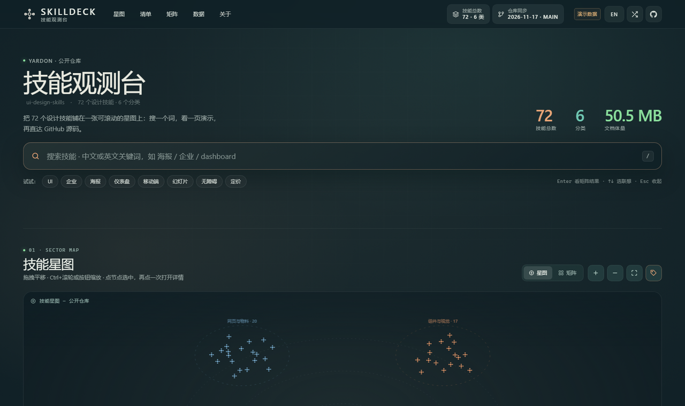
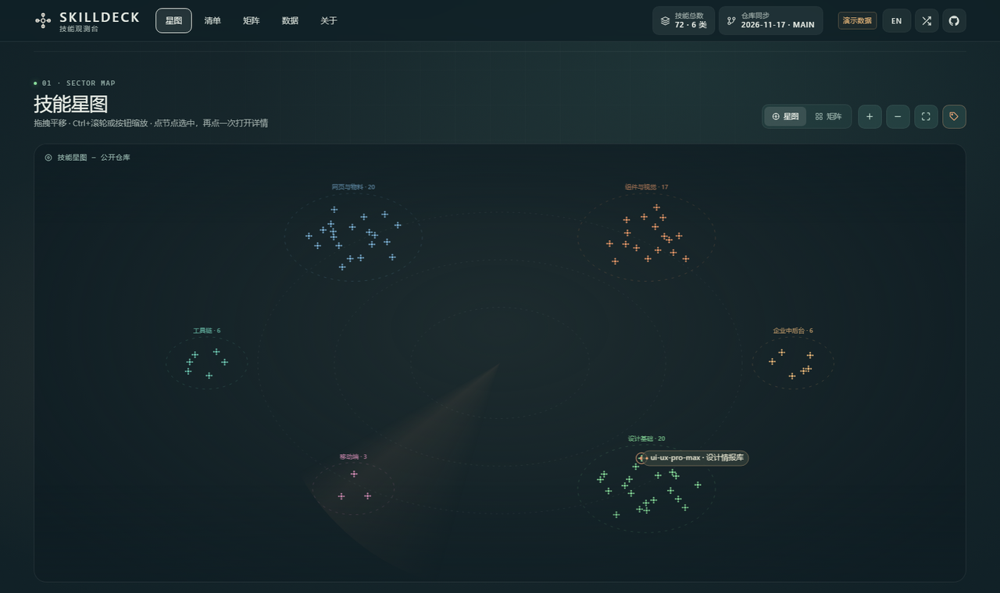
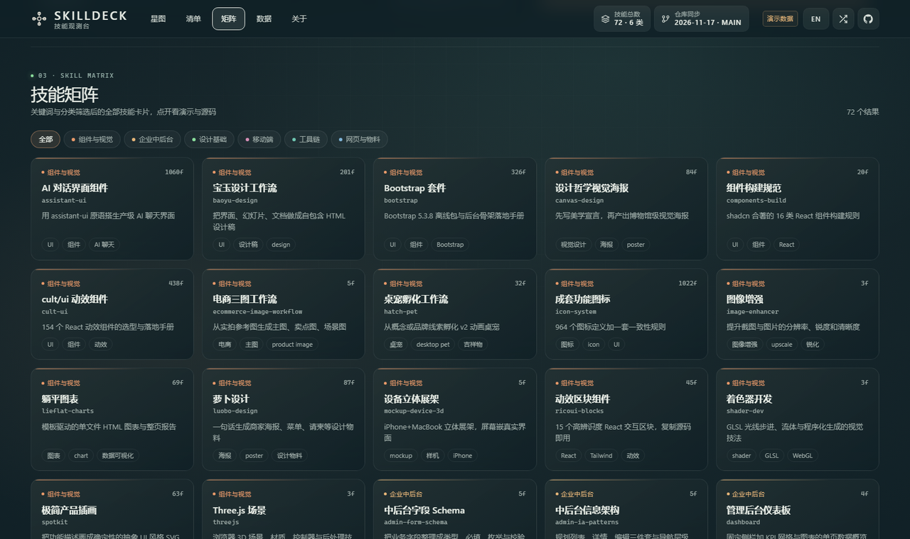
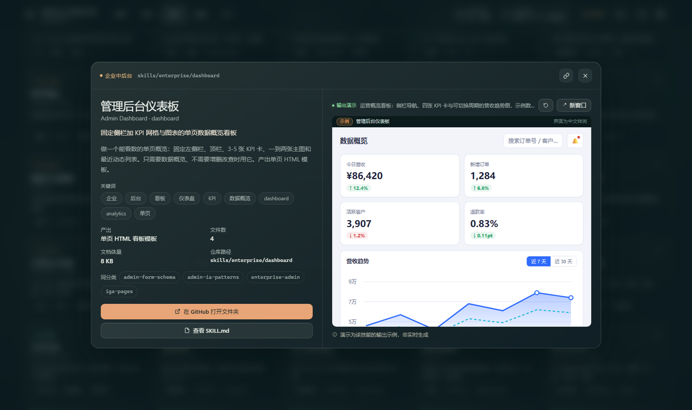
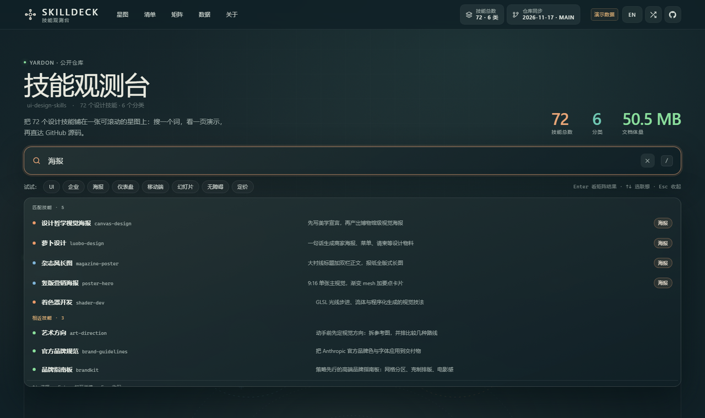
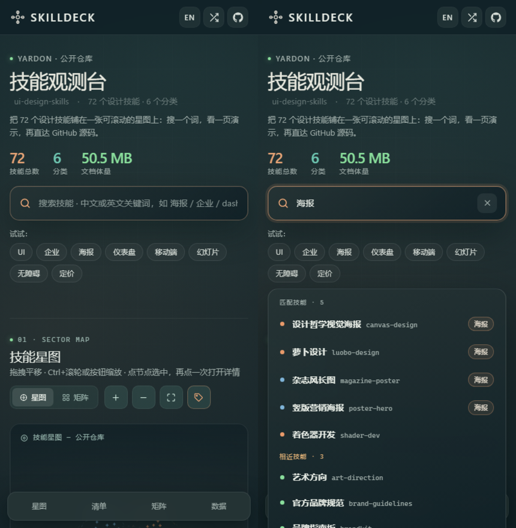
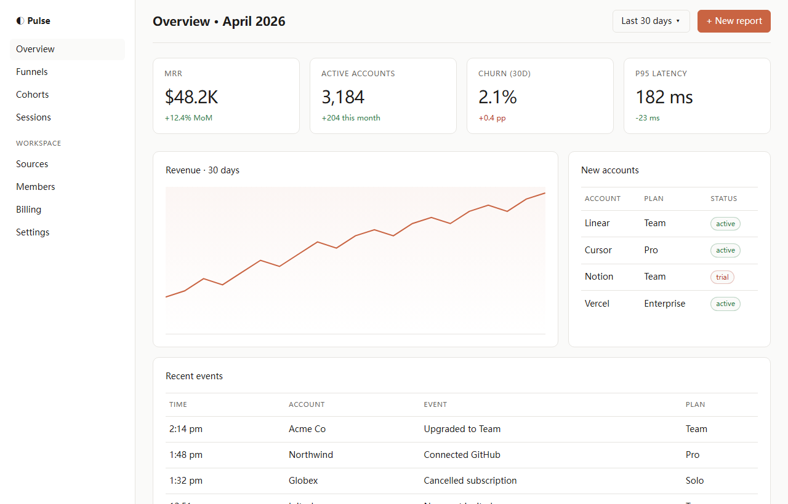
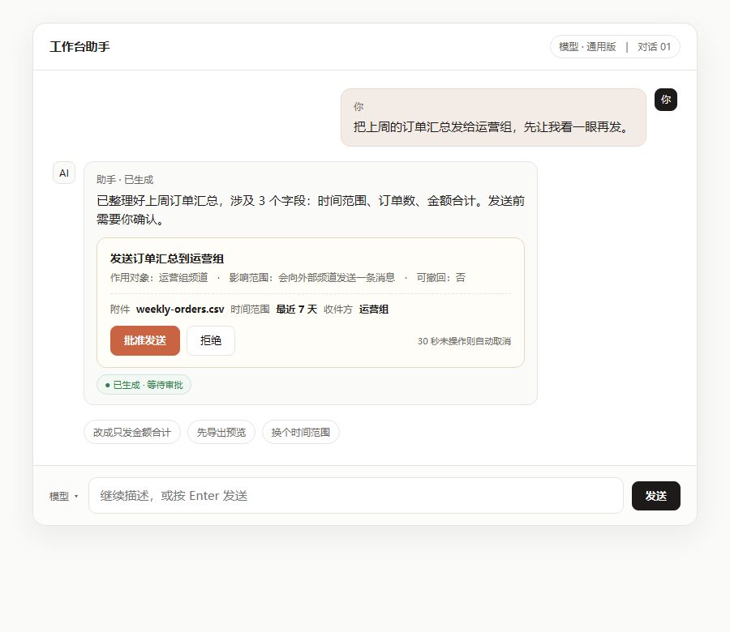
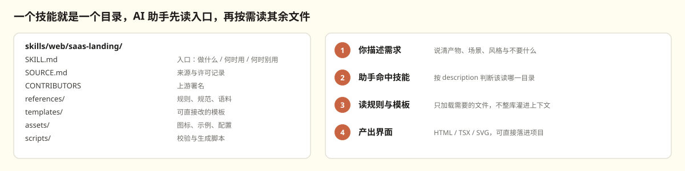
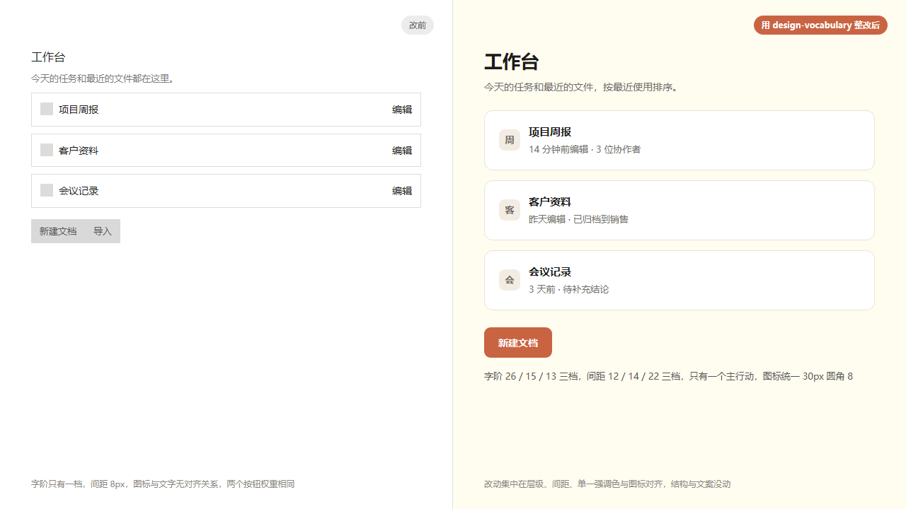

<div align="center">

# UI Design Skills


**Describe the product you want. The AI matches the right skill out of 72.** No directory browsing, no skill names to remember.


<a href="https://skill-observatory-x7alhjqexlp.qoder.zone"></a>
<a href="#03-30-second-start"></a>
<a href="#06-the-six-categories"></a>
<a href="#05-install-and-supported-assistants"></a>

[中文](./README.md) · English · [Contribute another language](https://github.com/YardonYan/ui-design-skills/issues)

[01 Board](#01-live-board) · [02 Proof](#02-see-it-working) · [03 Start](#03-30-second-start) · [04 Describe](#04-just-describe-the-product) · [05 Install](#05-install-and-supported-assistants) · [06 Catalog](#06-the-six-categories) · [07 Craft & provenance](#07-craft-and-provenance) · [08 Layout](#08-repository-layout) · [09 FAQ](#09-faq) · [10 License](#10-license)

</div>

This is a UI-design skill repository you can call as a whole. Point your AI at it, describe what you are building, for whom, and roughly how it should look; the repository does the matching itself. The root `SKILL.md` handles intent recognition, `docs/intent-routing.md` holds the decision rules and fallbacks, and the matched skills produce the actual output.

No clone required either: introductions, search, demos and source links for all 72 skills live on the public board below.

## 01 Live board

<div align="center">

<a href="https://skill-observatory-x7alhjqexlp.qoder.zone">

</a>

**Click anywhere on the image above to enter the board.** No clone, no login — all 72 skills on open.

</div>

The board is one scrollable page: search hero, skill star map, list & preview, skill matrix, library telemetry, about — six acts in order. The top bar sticks on scroll and navigation lands on each section; the star map pans by drag and zooms with Ctrl+wheel or the corner buttons.

The three images below are clickable too, each landing on its own view:

<table>
<tr>
<td width="33%" valign="top">

<a href="https://skill-observatory-x7alhjqexlp.qoder.zone">

</a>

Map · six clusters; click a node to select, click again for detail

</td>
<td width="33%" valign="top">

<a href="https://skill-observatory-x7alhjqexlp.qoder.zone/#view=grid">

</a>

Matrix · every card after keyword and sector filters

</td>
<td width="33%" valign="top">

<a href="https://skill-observatory-x7alhjqexlp.qoder.zone/#skill=dashboard">

</a>

Detail · bilingual brief + interactive demo + GitHub links

</td>
</tr>
</table>

### How to enter

Three ways, pick one:

1. **Click a badge or a screenshot**: the amber badge at the top of this page and every board image above are direct links.
2. **Type the address**: open `https://skill-observatory-x7alhjqexlp.qoder.zone` in a browser.
3. **Deep-link to an exact spot**: the URL hash carries view, query, language and skill id.

| Where you want to land | Link |
|---|---|
| Board home (star map) | `https://skill-observatory-x7alhjqexlp.qoder.zone` |
| Matrix view | `https://skill-observatory-x7alhjqexlp.qoder.zone/#view=grid` |
| A specific skill | `https://skill-observatory-x7alhjqexlp.qoder.zone/#skill=dashboard` |
| With a search query | `https://skill-observatory-x7alhjqexlp.qoder.zone/#q=poster` |
| English interface | `https://skill-observatory-x7alhjqexlp.qoder.zone/#lang=en` |

The copy-link button in the detail page builds the same kind of deep link for the current skill, carrying query, view and language — paste it to anyone and they land exactly where you were.

### Search that suggests

The search bar is the board's front door: type Chinese or English keywords and a dropdown answers immediately with two ranked groups — matching skills and related skills. A synonym table covers everyday wording: "admin" reaches dashboards, "pet" reaches the desktop-pet skill, "poster" pulls in visual-direction neighbours. ↑↓ to select, Enter opens the detail, Esc dismisses; the list and matrix filter and re-rank live.

<div align="center">



</div>

### Fully usable on phones

The same page stacks into one column on mobile with a fixed bottom bar jumping between map, list, matrix and data; suggestions, details and demos all work.

<div align="center">



</div>

### What is on the board

- Every skill carries a Chinese and an English introduction, bilingual search keywords and a one-page interactive sample demo.
- Demos are sample outputs in each skill's own style, labelled as not live-generated; every demo page carries a one-line bilingual note.
- Detail pages link straight to the skill folder and its `SKILL.md` on GitHub.
- The header toggle switches Chinese/English; keyword chips, suggestions and briefs follow.
- The telemetry act shows skill count, docs volume, demo coverage, sector distribution and recent commits.

<details>
<summary><b>Data scope and how to sync</b></summary>

Board data is a snapshot of this repository's main branch: counts, file totals and commit activity make zero requests, open offline and never hit GitHub rate limits. Bilingual copy lives in `board/content/`. After repository changes run:

```bash
node tools/sync_board.mjs --site <site-dir>
```

The script scans `skills/` frontmatter, merges the copy, checks demo coverage and regenerates `data/skills.json`; then republish the site.

</details>

## 02 See it working

All four images below are real output. Under each image is the sentence the user said, plus the skills the repository matched on its own. You only say the first part; the second line is the AI's own decision.

<table>
<tr>
<td width="50%" valign="top">


Web · AI matched `saas-landing`

> I need a homepage for a file-sync product. Top bar, hero, three feature cards, pricing and FAQ. Desktop 1440 first, single column on mobile.

</td>
<td width="50%" valign="top">



Enterprise · AI matched `dashboard`

> I need an operations dashboard. Fixed left nav, search and notifications on top, four KPI cards, a 30-day trend line, an accounts table and a recent-events list.

</td>
</tr>
<tr>
<td width="50%" valign="top">


Mobile · AI matched `mobile-app`

> I need a focus-timer app, one screen, inside an iPhone 15 Pro frame: status bar, dynamic island, main timer card, today stats, todo list and bottom tab bar.

</td>
<td width="50%" valign="top">



AI chat · AI matched `assistant-ui` + `ai-chat-patterns`

> I need an AI assistant interface with tool approval: streaming, manual stop, retry, follow-up suggestions, and an approval card stating target, impact, reversibility, approve/deny side by side, and timeout behaviour.

</td>
</tr>
</table>

None of the four sentences names a skill; the repository decided which `SKILL.md` files to read. Open the matching HTML in `assets/demos/` to reproduce these images; the board's per-skill demo pages come from the same pipeline.

## 03 30-second start

Find your situation first:

| Your situation | Start here |
|---|---|
| Want to browse all 72 skills | Open the [live board](#01-live-board): map, search, demos, straight to source |
| Just want to see what it can do | Look at the four images in [02 See it working](#02-see-it-working) |
| Have a task and need an interface | Jump to [04 Just describe the product](#04-just-describe-the-product) and adapt one sentence |
| Want it inside your project or team | See [05 Install and supported assistants](#05-install-and-supported-assistants); clone once, call as a whole |

Three steps:

1. Put the whole repository in your workspace, by cloning it or downloading a zip.
2. Tell your AI to call this repository and read the root `SKILL.md` first.
3. Describe only the product you want. No directory browsing, no skill names.

The smallest usable prompt:

```
Call the UI Design Skills repository, read the root SKILL.md first, match skills from my description.
I want: <one sentence: what the product is and who it is for>. Output a single-file HTML I can open directly.
```

It also works without installing: paste the root `SKILL.md` into the conversation and let the AI read the matched skill files on demand. Installing once only saves you from pointing at files every time.

## 04 Just describe the product

This table is routing evidence for the AI, not a quiz for you. You do not need to memorise it or name skills in prompts; the more your description sounds like ordinary speech, the better the match.

| You would probably say | AI usually matches | What you get |
|---|---|---|
| A product site, landing page, homepage | `saas-landing` | One page with hero, features, social proof, pricing |
| A SaaS pricing page, three tiers | `pricing-page` | Monthly/yearly toggle, comparison table, FAQ |
| A FAQ or docs site | `faq-page`, `docs-page` | Q&A page and three-column docs page |
| An admin panel, order system, CRM pages | `enterprise-admin` | Admin page structure and field definitions |
| Turn these fields into a validatable form | `admin-form-schema` | Field list, types, validation rules, example JSON |
| A dashboard to watch data | `dashboard`, `live-dashboard` | KPI grid, trend charts, activity feed |
| An app, show me one screen | `mobile-app` | One app screen inside a device frame |
| iOS / Android / mini-program dimensions | `mobile-design-spec` | Five size specs with safe-area values |
| An AI assistant with an approval chat UI | `assistant-ui` | Runtime wiring, components, ready UI elements |
| Which states must a chat UI handle | `ai-chat-patterns` | State list and 20 acceptance items |
| A consistent icon set | `icon-system` | ~1000 icon definitions and naming rules |
| Illustrations, empty-state art | `spotkit` | Deterministic SVG, light and dark themes |
| Light/dark palette for the product | `flexoki-palette` | Palette CSS with light/dark mapping |
| This UI looks AI-generated, fix it | `unslop` | Itemised corrections, no full rewrite |
| Audit guidelines and accessibility | `web-design-guidelines` | Compliance issue list |
| Turn this design image into code | `image-to-code` | Recreated page code |
| Clone this site | `web-clone` | Section-by-section recreation path |
| A single-file report, then PDF | `html-skill-effectiveness`, `html-to-pdf` | Deliverable files |

Full indexes: `ROUTER.md` (by spoken wording), `docs/skill-map.md` (by the six-stage interface pipeline), plus the intent notes below.

### Prompt templates

Every block below assumes the whole repository is already handed to your AI. You say what to build; which `SKILL.md` to read is decided by `docs/intent-routing.md`. Do not write skill paths in prompts, and do not browse the directory first.

The universal formula:

```
Call the UI Design Skills repository, read the root SKILL.md first, match skills from my description and finish.
I want: [one product / page / interface, one sentence on who it serves and what it solves].
Constraints: [React / single-file HTML / mobile / no external deps — omit if none].
Style and exclusions: [restrained / editorial / no purple gradients or glow — omit if none].
Output: [a page I can open / an icon set / an acceptance checklist].
Finish with one sentence naming the skills you matched and why.
```

<details>
<summary><b>Copy by scenario: landing, pricing, admin, form, mobile, chat, palette, icons, rework, audit</b></summary>

Landing page

```
I need a homepage for a developer-facing API monitoring product. Restrained style, warm paper background, no purple gradients or glow.
Top bar, large-type hero, two CTAs, four feature cards, three-step flow, three pricing tiers, FAQ and footer.
Give me a single-file HTML I can open directly.
```

Pricing page

```
I need a pricing page for a SaaS product, three tiers, middle one marked recommended.
Monthly/yearly toggle, full feature comparison table and FAQ. Use placeholder prices, never invent real ones.
```

Enterprise admin

```
I need an order-management admin, list page first: filter zone, bulk actions, pagination, status tags and inline edit entry.
Only these fields: order id, customer, amount, status, created at. Do not add fields on your own.
```

Form rules

```
Turn this field set into a validatable form schema: types, required, defaults, enum dictionaries, validation timing, error messages.
Give me example JSON. Never add fields that are not in the material.
```

Mobile

```
I need a habit-tracker app, one screen, inside an iPhone frame: status bar, today progress,
seven-day heat strip, todo list and four bottom tabs. Check safe areas and touch targets against the spec.
```

AI chat interface

```
I need an AI assistant interface with tool approval: streaming, manual stop, retry, follow-up suggestions,
and a tool-call approval card stating target, impact, reversibility, approve/deny side by side, and timeout behaviour.
```

Palette

```
Give a long-form reading docs site light and dark palettes. Body contrast must pass; colour only as semantic accent.
Give me a CSS variable table, not a second list of hex values.
```

Icons

```
Eight function icons for a file manager: new, upload, download, share, archive, search, delete, settings.
Identical stroke width, radius and padding; derive colour from one primary; export standalone static SVG.
```

Rework an existing UI

```
This HTML looks AI-generated. Correct it, do not rewrite: keep the structure,
list evidence with locations first, then fix in rounds by spacing, colour, icons, copy, type, layout — one class of problem per round.
```

Audit

```
Audit this interface against the checklist. Output issues and locations only, do not change anything.
```

</details>

<details>
<summary><b>The more precise the description, the steadier the output: seven contrasts</b></summary>

| You might say | Better | Why |
|---|---|---|
| Make a nice page | A developer-facing pricing page, three tiers, restrained, warm paper | "Nice" has no acceptance criteria; artifact, tiers and style do |
| Make an admin | An order-admin list page with exactly these five fields | "Admin" is too broad; without a field fence it invents fields |
| Like some big company's site | Large type, narrow body column, thin borders, no gradients | Copying a product carries copyright risk; describing traits is safer |
| A few icons | Eight function icons, uniform stroke and radius, one primary | Count and invariants decide whether it is a set |
| Make it nicer | Only the second screen's card spacing and title weight | Without a boundary the assistant rewrites the page |
| Which skill should I use | Don't worry about it, just say what you are building | Routing is the repository's job, not yours |
| Use our internal fields | Abstract field names; I fill real values locally | Internal material never goes into public artifacts |

For follow-up rounds:

```
Keep the overall structure; change only [one property] of [one region]; nothing else moves.
```

```
List the trade-offs you made, marking which ones I never asked for.
```

```
Audit the motion, report issues only, do not change yet.
```

```
One more version on a dark background, reusing the same palette.
```

</details>

### Intent recognition and fallbacks

When the request is vague or spans categories, the repository does not stall. The decision logic lives in two files, both written for the AI:

| File | Responsibility |
|---|---|
| Root `SKILL.md` | Entry point: four-step flow, quick mappings and hard rules — never ask the user to name a skill |
| `docs/intent-routing.md` | Intent notes: four decision dimensions, natural-language signal words, six-category mapping, conflict arbitration, fallback path and counter-examples |

Decisions walk four dimensions and stop as soon as one is enough: what is the artifact, what is the carrier, which stage, which constraints. Artifact weighs most, then carrier.

The fallback is a fixed six-step path; stop at the first step that settles it:

1. If the artifact fits one of six categories, enter that category's primary skill.
2. Artifact unclear but carrier visible: web starts at landing, admin at admin pages, phone at one app screen, chat at the assistant interface.
3. Carrier unclear but stage visible: rework goes to corrections, acceptance to guideline audit, direction-setting to art direction.
4. All four vague: ask at most two questions — page, interface or file? For whom, on which device? No interrogation, no directory browsing.
5. Still nothing: offer a direction draft to pick from, better than waiting.
6. Clearly not an interface (Word, PDF, PPT, backend API, data analysis): say it does not apply, do not force a skill.

Conflicts have explicit arbitration: CRUD plus fields goes to admin, display plus conversion goes to web; a whole page goes to page skills, one reusable block to component skills; icons plus palette picks the primary artifact's skill with palette as support. Multi-skill combinations follow direction, structure, draft, assets, acceptance — at most two supporting skills.

If a match feels wrong, say so and it swaps the primary skill and redoes the work; no need to re-explain the requirement.

## 05 Install and supported assistants

You install the whole repository, not one skill directory. Zero-dependency installer, Node 18+:

```bash
node tools/install.mjs --list
node tools/install.mjs --skill saas-landing --ai workbuddy
node tools/install.mjs --skill all --ai workbuddy --dry-run
```

For whole-repository calling, cloning into the workspace is enough. The installer suits cases where skills must land in a specific assistant directory; install only what you use. It verifies every skill root actually contains `SKILL.md` before copying and refuses the whole batch if one is missing.

Chinese tools come first and work out of the box; overseas tools usually need external network access.

| Assistant | `--ai` id | Default user-level directory |
|---|---|---|
| WorkBuddy | `workbuddy` | `~/.workbuddy/skills/` |
| CodeBuddy | `codebuddy` | `~/.codebuddy/skills/` |
| TRAE CN | `trae-cn` | `~/.trae-cn/skills/` |
| Qoder | `qoder` | `~/.qoder/skills/` |
| Qwen Code | `qwen-code` | `~/.qwen/skills/` |
| OpenClaw | `openclaw` | `~/.openclaw/skills/` |
| Claude Code | `claude` | `~/.claude/skills/` |
| Codex | `codex` | `~/.codex/skills/` |
| Cursor | `cursor` | `~/.cursor/skills/` |

Directories are defaults; override with `--dir`. The repository also works as a plugin marketplace source, with four plugin manifests at the root:

```bash
claude plugin marketplace add YardonYan/ui-design-skills
```

Web IDEs, cloud shells and online notebooks do not apply — they have no skill-loading entry. When you need a running interface, drop the skill's templates into your own project.

<details>
<summary><b>Full installer parameter table</b></summary>

| Parameter | Effect |
|---|---|
| `--list` | List all skills and categories |
| `--skill <name>` / `--skill all` | One skill or all |
| `--ai <id>` / `--ai all` | One assistant, or every configured assistant at once |
| `--project` | Install into the current project instead of the user directory |
| `--dir <path>` | Explicit target directory, overriding defaults |
| `--dry-run` | Print what would be copied |
| `--force` | Overwrite existing targets |
| `--uninstall` | Remove skills installed by this repository |

</details>

## 06 The six categories

Once you can use it, look at the whole library once so you can add skills on demand instead of searching from scratch each time. Category names are the `cat` parameter in board deep links.


| Category | Covers | Skills | Representatives | Board |
|---|---|---:|---|---|
| `foundations` | Direction, palette, brand, interaction states, acceptance & rework | 20 | `oil-ui`, `flexoki-palette`, `ai-chat-patterns`, `unslop` | [View sector](https://skill-observatory-x7alhjqexlp.qoder.zone/#cat=foundations) |
| `web` | Public-facing pages and page types | 20 | `saas-landing`, `pricing-page`, `web-clone` | [View sector](https://skill-observatory-x7alhjqexlp.qoder.zone/#cat=web) |
| `enterprise` | Admin, forms, information architecture, dashboards | 6 | `enterprise-admin`, `admin-form-schema` | [View sector](https://skill-observatory-x7alhjqexlp.qoder.zone/#cat=enterprise) |
| `mobile` | App screens, onboarding, multi-device specs | 3 | `mobile-app`, `mobile-design-spec` | [View sector](https://skill-observatory-x7alhjqexlp.qoder.zone/#cat=mobile) |
| `components` | Components, blocks, icons, illustration, charts, AI chat parts | 17 | `cult-ui`, `icon-system`, `assistant-ui` | [View sector](https://skill-observatory-x7alhjqexlp.qoder.zone/#cat=components) |
| `tooling` | Debugging, conversion, canvas formats, delivery | 6 | `chrome-devtools`, `html-to-pdf`, `json-canvas` | [View sector](https://skill-observatory-x7alhjqexlp.qoder.zone/#cat=tooling) |

### What a skill looks like

After the whole picture, understand how one skill directory is read — editing templates gets easier.



Each skill is a directory; `SKILL.md` is the entry. Its YAML frontmatter requires `name` and `description`, and the description states what it does, when to use it and when not to. The agent loads only matched files, never all 72 skills into context. Validate formats with `python tools/lint_skills.py`.

## 07 Craft and provenance

Five skills were adapted from UI-skill content other people shared; they are now part of the 72, installable and routable like the rest. Four images below are real runs; the fifth produces text, printed directly.

### Before / after: what design vocabulary buys


Same copy, same structure; the animation alternates before and after. The next image puts both versions side by side for item-by-item comparison.



> This interface looks flat. Rework it dimension by dimension with design-vocabulary; keep the structure.

Only four classes of change: type scale, spacing, radius, one accent colour. Not one word of copy changed, not one block moved.

### Three art directions: set the tone before the page


> I'm building an AI note tool. Give me three visual directions side by side with art-direction first.

One product sentence, three tones: restrained editorial, warm paper, cold tech. Pick one before building — one rework round saved.

### Accessibility audit: list only, hands off


> Audit this interface with a11y-rules. Issues and locations only, do not change yet.

Output is graded items with evidence and suggestions, citing WCAG clauses. Audits never quietly edit your code.

### Motion recipes: three frames per interaction


> This card hover is stiff. Give me a recipe with motion-craft.

Travel, shadow, easing and duration are all spelled out, including what survives reduced motion.

### Motion prompts: freeze the effect into reusable words

`motion-prompts` outputs text. To reproduce the card lift above, this is what you hand the AI:

```
In motion-prompts format, write a reusable prompt for a card hover lift.
Name: hover lift
Rhythm: 0 → -10px → -3px, 240ms, ease-out
Shadow: 2px → 14px → 6px, in sync with travel
Fallback: under prefers-reduced-motion keep only the shadow change
```

### External resource index

The repository holds 72 skills, five of them adapted from shared UI-skill content and promoted into `skills/`. Calling this one repository is enough; no need to hunt through other skill libraries. A nine-class resource index is available on demand.

| Part | Path | Content | When to use |
|---|---|---|---|
| Integrated skills | `skills/foundations/` | `design-vocabulary`, `art-direction`, `a11y-rules`, `motion-craft`, `motion-prompts` | Craft, art direction, accessibility, motion, prompt writing |
| Resource index | `references/resources/` | 37 repository links + 103 sites | Component libraries, inspiration sites, palette tools, UI prompt libraries, templates |

Integrated skills are formal skills with uniformly named `SKILL.md`: installable, routable, validatable. External rule texts were adapted into each skill's `references/`. Existing `hallmark`, `ui-ux-pro-max`, `frontend-design`, `emil-design-eng` and the 84 DESIGN.md corpora are not duplicated. Attribution and licenses are registered in `THIRD-PARTY.md`.

The resource index is not read by default. Artifact requests go to skills; only signals like find / is-there / reference / inspiration open `references/resources/INDEX.md` and then one matched category file. Full rules in `docs/resource-routing.md`.

To combine skills with external experience:

```
Call the UI Design Skills repository. I want a landing page for an AI note product.
Match skills by intent and build the page first, then check spacing and colour craft with design-vocabulary.
```

The link list's source of truth is `references/resources/SOURCE.md`; category files and INDEX are generated by `tools/build_resource_index.py`. Change links only in the source, then rerun the script.

## 08 Repository layout

```
ui-design-skills/
├── SKILL.md               # Entry: intent recognition, four-step flow, hard rules
├── ROUTER.md              # Spoken wording → skill index
├── skills/                # 72 skills in six categories by final artifact
│   ├── foundations/       #   20 · direction, palette, brand, acceptance
│   ├── web/               #   20 · landing, pricing, docs, cloning
│   ├── enterprise/        #    6 · admin, forms, dashboards
│   ├── mobile/            #    3 · app screens and device specs
│   ├── components/        #   17 · components, icons, illustration, charts
│   └── tooling/           #    6 · debugging, conversion, delivery
├── board/content/         # Bilingual copy and keywords for the live board
├── docs/                  # Intent routing, skill map, resource routing, troubleshooting
├── references/resources/  # Nine-class external resource index
├── assets/                # Cover, diagrams, real screenshots, board images, badges
└── tools/                 # Installer, validators, index builders, board sync
```

Engineering companions live in `tools/`: zero-dependency installer `install.mjs`, format validator `lint_skills.py`, sensitive-word scan `scan_sensitive.py`, resource index `build_resource_index.py`, README diagrams `gen_readme_images.py`, board data sync `sync_board.mjs`.

<details>
<summary><b>What changed in v2.3</b></summary>

| Change | Notes |
|---|---|
| External resources & integrated skills | Nine-class index (37 repos + 103 sites); five external skills adapted into `skills/foundations/` as formal, installable, validatable, routable skills |
| Intent entry | Root `SKILL.md` + `docs/intent-routing.md`: the whole repository callable as one Skill; users describe products, AI matches, with conflict arbitration and six-step fallback |
| Six-category reorganisation | 72 skills grouped by final artifact into foundations, web, enterprise, mobile, components, tooling |
| AI chat pipeline | `assistant-ui` component payload + `ai-chat-patterns` interaction spec: streaming, tool approval, branching, accessibility acceptance |
| Assets & palette | `icon-system` icon set, `ricoui-blocks` motion blocks, `flexoki-palette` ink palette |
| Prompt template library | Universal formula, ten scenario prompts, contrasts and follow-ups — all product-description style, no skill paths |
| Real output & diagrams | Four real UI screenshots, cover and three diagrams, reproducible via `tools/gen_readme_images.py` |
| Engineering | Four plugin manifests, zero-dependency installer, three validators |
| Public face | Bilingual README rewritten for new visitors; repository renamed ui-design-skills; About and topics updated |
| Live board | Bilingual briefs, suggesting search, interactive demos and GitHub deep links for all 72 skills on one scrollable public site |

</details>

For a skill's provenance and license see `THIRD-PARTY.md`; for full indexes see `ROUTER.md` and `docs/skill-map.md`.

## 09 FAQ

| Question | Answer |
|---|---|
| Do I need to know skill names | No. Describe the product; the AI matches via root `SKILL.md` and `docs/intent-routing.md` |
| What if the match is wrong | Add one sentence on artifact form or platform; if still wrong, state the expected output and it swaps the primary skill |
| Can I use it without installing | Yes. Paste the root `SKILL.md` into the conversation and let the AI read matched files on demand |
| Do I install all 72 at once | No. For whole-repository calling, one clone is enough |
| Can generated UIs ship as-is | Templates are a start: wire real data, brand and backend; audit against guidelines before shipping |
| Will vague requests stall it | No. Six-step fallback, at most two clarifying questions, or a direction draft to pick from |
| Will links and external skills flood context | No. The resource index is not loaded by default; integrated skills hit 1–3 per normal flow |
| How do I reproduce the images | Source HTML in `assets/demos/`; rerun `python tools/gen_readme_images.py` |
| Are board demos live-generated | No. They are pre-generated sample outputs in each skill's style, labelled on the page; data is a main-branch snapshot |
| I want a different style | Just say the style; when unsure, ask for two or three direction drafts first |

Troubleshooting notes live in `docs/troubleshooting.md`, every entry from real run output.

## 10 License

Own content Apache-2.0, see `LICENSE`. Third-party content keeps its own licenses, itemised in `THIRD-PARTY.md`, exceptions in `NOTICE`. Illustrations, diagrams and screenshots live in `assets/`, generated by `tools/gen_readme_images.py` and reproducible; board screenshots come from the public site's actual pages.

<div align="center">

<a href="https://skill-observatory-x7alhjqexlp.qoder.zone"></a>

[Back to top](#ui-design-skills) · [Live board](https://skill-observatory-x7alhjqexlp.qoder.zone) · [中文](./README.md)

</div>