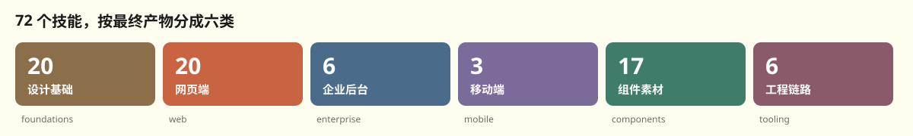

<div align="center">

# UI Design Skills

Turn one sentence into an interface your AI gets right the first time. 67 skills, each solving one class of interface problem.

</div>


<div align="center">


Current release v2.3 · 67 skills · Apache-2.0

[中文](./README.md) · English · [Contribute a translation](https://github.com/YardonYan/ui-design-skills/issues)

[See it working](#see-it-working) · [30-second start](#30-second-start) · [Install](#install-and-supported-assistants) · [What UI do you want](#what-ui-do-you-want) · [Copy-paste prompts](#copy-paste-prompts) · [Six categories](#whats-in-the-six-categories) · [What's new in v2.3](#whats-new-in-v23) · [FAQ](#faq)

</div>

No commands to memorise, no skill names to remember. The sections below move from seeing the output, to getting started, to choosing a scenario, to copying prompts, to understanding the whole library. Every prompt can be copied as a whole block.

## See it working

All four images are real output from skills in this repository, not mockups. Open the matching HTML in `assets/demos/` in a browser to reproduce them. The line under each image is the prompt that produced it.

<table>
<tr>
<td width="50%" valign="top">


Web · `saas-landing`

> Read `skills/web/saas-landing/SKILL.md` and build the homepage for a file-sync product following its layout. Include top nav, hero, three feature cards, pricing and FAQ. Desktop 1440 first, single column on mobile.

</td>
<td width="50%" valign="top">


Enterprise · `dashboard`

> Read `skills/enterprise/dashboard/SKILL.md` and build an operations dashboard. Fixed left nav, top search and notifications, four KPI cards, a 30-day trend chart, an account table and a recent-events list.

</td>
</tr>
<tr>
<td width="50%" valign="top">


Mobile · `mobile-app`

> Read `skills/mobile/mobile-app/SKILL.md` and build one focus-timer app screen inside an iPhone 15 Pro frame. Include status bar, dynamic island, main timer card, today stats, a task list and a bottom tab bar.

</td>
<td width="50%" valign="top">


AI chat · `assistant-ui` + `ai-chat-patterns`

> Read `skills/foundations/ai-chat-patterns/SKILL.md` to enumerate every state, then build the chat interface following `skills/components/assistant-ui/SKILL.md`. Include a tool-approval card stating the action, its scope, whether it is reversible, with Approve and Reject side by side and a visible timeout rule.

</td>
</tr>
</table>

The four images cover web, enterprise, mobile and AI chat. The other 63 skills cover colour, icons, components, review, conversion and debugging. The pattern is identical: swap the skill path and describe the output.

## 30-second start

The shortest path is three steps:

1. Get the repository. Clone it, or just download the one skill directory you need.
2. Pick the closest scenario in "What UI do you want" and copy its prompt.
3. Send it to your agent. The agent reads `SKILL.md` and, when needed, `references/` and `templates/` in the same directory.

The smallest prompt that works. Replace the angle brackets:

```
Read skills/<category>/<skill>/SKILL.md and build <output> following its rules.
Context: <who uses it, where>. Style: <one phrase>. Must include: <three to five items>.
Avoid: <things to exclude>. Deliver a single self-contained HTML file I can open directly.
```

You can use it without installing anything: paste the body of `SKILL.md` into the conversation. Installing once simply means the agent reads the right file on its own from then on.

## Install and supported assistants

Zero dependencies, Node 18 or newer:

```bash
node tools/install.mjs --list
node tools/install.mjs --skill saas-landing --ai workbuddy
node tools/install.mjs --skill all --ai workbuddy --dry-run
```

Install only the one you need, not all of them. The installer verifies every selected skill has `SKILL.md` at its root and refuses the whole batch otherwise.

| Flag | Effect |
|---|---|
| `--list` | List every skill and category |
| `--skill <name>` / `--skill all` | Pick one skill or all |
| `--ai <id>` / `--ai all` | Install into one assistant or all configured assistants |
| `--project` | Install into the current project instead of the user-level directory |
| `--dir <path>` | Explicit target directory, overrides the default |
| `--dry-run` | Print planned copies without writing |
| `--force` | Overwrite an existing target |
| `--uninstall` | Remove skills installed from this library |

Domestic tools first (usable without a proxy in mainland China), then international tools (usually need outbound access).

| Assistant | `--ai` id | Default user-level directory |
|---|---|---|
| WorkBuddy | `workbuddy` | `~/.workbuddy/skills/` |
| CodeBuddy | `codebuddy` | `~/.codebuddy/skills/` |
| TRAE CN | `trae-cn` | `~/.trae-cn/skills/` |
| Qoder | `qoder` | `~/.qoder/skills/` |
| Qwen Code | `qwen-code` | `~/.qwen/skills/` |
| OpenClaw | `openclaw` | `~/.openclaw/skills/` |
| Claude Code | `claude` | `~/.claude/skills/` |
| Codex | `codex` | `~/.codex/skills/` |
| Cursor | `cursor` | `~/.cursor/skills/` |

These are defaults; override with `--dir`. The repository also works as a plugin-marketplace source, with four manifests at the root:

```bash
claude plugin marketplace add YardonYan/ui-design-skills
```

Browser IDEs, cloud shells and online notebooks are not applicable: they have no skill loader. To get a running interface, take the templates into your own project.

## What UI do you want

Once installed, settle the output type before writing a prompt. Picking the wrong skill costs more than imperfect wording.


When unsure, classify by the final output: if it is a web page or an interface, it belongs here; if it is a Word, PDF or PPT file, it is out of scope.

| What you would probably say | Skill | What you get |
|---|---|---|
| Build a product homepage / landing page | `saas-landing` | Hero, features, social proof, pricing, one page |
| Build a pricing page with three tiers | `pricing-page` | Monthly/annual toggle, comparison table, FAQ |
| Build a FAQ or docs site | `faq-page`, `docs-page` | Q&A page and three-column docs page |
| Build an admin with list, detail and edit pages | `enterprise-admin` | Back-office page structure and field definitions |
| Turn a pile of fields into a validated form | `admin-form-schema` | Field list, types, validation rules, sample JSON |
| Build a metrics dashboard | `dashboard`, `live-dashboard` | KPI grid, trend chart, activity feed |
| Render one app screen | `mobile-app` | A single screen inside a device frame |
| Look up iOS / Android / mini-program dimensions | `mobile-design-spec` | Five platform specs and safe-area values |
| Build an AI chat interface / approval card | `assistant-ui` | Runtime wiring, components, ready-made elements |
| Enumerate every state a chat UI must handle | `ai-chat-patterns` | State list and a 20-item acceptance checklist |
| Need a full set of consistent icons | `icon-system` | Nearly a thousand icon definitions and naming rules |
| Need illustrations / empty states | `spotkit` | Deterministic SVGs, light and dark |
| Need a palette for a reading-heavy UI | `flexoki-palette` | Palette CSS and light/dark mapping |
| This looks AI-generated, fix it | `unslop` | Line-by-line critique, no full rewrite |
| Review interface and accessibility compliance | `web-design-guidelines` | A list of compliance issues |
| Turn a mockup or screenshot into code | `image-to-code` | Reconstructed page code |
| Clone a site | `web-clone` | Section-by-section reconstruction path |
| HTML to PDF / single-file report | `html-to-pdf`, `html-skill-effectiveness` | Deliverable files |

All 67 skills are indexed in `ROUTER.md` (by what you would say) and `docs/skill-map.md` (by the six stages of making an interface).

## Copy-paste prompts

Scenario settled, the remaining question is how to describe it. This section is for people who do not want to study the skills first. Copy a whole block and change only the bracketed parts.

### Universal formula

```
Read skills/[category]/[skill]/SKILL.md and build [output] following its rules.
Context: [who uses it, where]. Style: [restrained / editorial / enterprise / playful].
Must include: [three to five items, e.g. top nav, hero, three feature cards, pricing, FAQ].
Avoid: [purple gradients, glows, emoji labels, wide-tracked uppercase, ...].
Constraints: single self-contained HTML, no external dependencies, works at 1440 and on mobile.
When done, list the choices you made.
```

### By scenario

Landing page

```
Read skills/web/saas-landing/SKILL.md and build the homepage for a developer-facing
API monitoring product. Restrained style, warm paper background, no purple gradients
or glows. Include top nav, large hero, dual CTA, four feature cards, a three-step
flow, three pricing tiers, FAQ and footer. Single HTML file.
```

Pricing page

```
Read skills/web/pricing-page/SKILL.md and build a three-tier pricing page.
Mark the middle tier as recommended. Include a monthly/annual toggle, a full
feature comparison table and FAQ. Use placeholder numbers, do not invent real prices.
```

Enterprise admin

```
Read skills/enterprise/enterprise-admin/SKILL.md and build the list page of an
order-management admin. Include filters, bulk actions, pagination, status badges
and an inline-edit entry point. Use only these fields: order id, customer, amount,
status, created at. Do not add fields I did not give you.
```

Form schema

```
Read skills/enterprise/admin-form-schema/SKILL.md and turn this field set into a
validated schema: types, required flags, defaults, enum dictionaries, validation
timing and error messages. Give sample JSON. Never invent fields absent from the input.
```

Mobile

```
Read skills/mobile/mobile-app/SKILL.md and build one habit-tracker screen.
Put it in an iPhone frame with status bar, today's progress, a seven-day streak,
a task list and four bottom tabs. Also read skills/mobile/mobile-design-spec/SKILL.md
and check safe areas and touch targets.
```

AI chat interface

```
Read skills/foundations/ai-chat-patterns/SKILL.md to enumerate states, then build
the chat interface following skills/components/assistant-ui/SKILL.md. Include
streaming output, manual stop, retry on failure, follow-up suggestions, and a
tool-approval card. The card must state the action, its scope, whether it is
reversible, show Approve and Reject side by side, and display the timeout rule.
```

Colour

```
Read skills/foundations/flexoki-palette/SKILL.md and references/palette.css and
give me light and dark themes for a long-form reading site. Body text must have
enough contrast, colour is for semantics only. Deliver CSS variables; do not
write a second copy of the hex values.
```

Icons

```
Read skills/components/icon-system/SKILL.md and make eight functional icons for a
file manager: new, upload, download, share, archive, search, delete, settings.
Stroke width, corner radius and padding must match across the set, all colours
derived from one accent. Export standalone static SVGs at the end.
```

Fix an existing interface

```
Read skills/foundations/unslop/SKILL.md and critique this HTML. Do not rewrite the
whole page. Keep the structure, first list the AI-look evidence with locations,
then fix in passes: spacing, colour, icons, copy, type, layout. One class per pass.
```

Review

```
Read skills/foundations/web-design-guidelines/SKILL.md and
skills/foundations/ai-chat-patterns/references/acceptance-checklist.md and review
this interface. Report issues and their locations only, do not edit yet.
```

### More precise input, more predictable output

| You might say | Say instead | Why |
|---|---|---|
| Make a nice page | Build a developer pricing page, three tiers, restrained, warm paper | Nice has no acceptance criteria; output, tiers and style do |
| Build an admin | Build an order list page with exactly these five fields | Admin is too broad; unlisted fields appear by guesswork |
| Make it like that big product | Large headline, narrow body column, hairline borders, no gradients | Describing traits is safer than copying a specific product |
| A few icons, whatever | Eight functional icons, shared stroke and radius, one accent | Count and invariants are what make a set |
| Make it look better | Only change card spacing and heading weight in section two | Without a boundary the agent rewrites everything |
| Use our internal field names | Use abstract field names; I will fill real ones locally | Keep internal data out of external services and public output |

### Follow-up prompts

```
Keep the overall structure. Change only [one property] of [one region]. Leave everything else alone.
```

```
List every choice you made and flag the ones I did not ask for.
```

```
Review the motion with skills/foundations/review-animations/SKILL.md. Report issues only, do not edit yet.
```

```
Produce a dark variant using skills/foundations/flexoki-palette/references/palette.css.
```

## What's in the six categories

Once you can use a skill, take in the whole library so you can add skills as needed instead of searching from scratch every time.



| Category | Scope | Skills | Representative |
|---|---|---:|---|
| `foundations` | Direction, colour, branding, interaction states, review | 15 | `oil-ui`, `flexoki-palette`, `ai-chat-patterns`, `unslop` |
| `web` | Public-facing pages and page types | 20 | `saas-landing`, `pricing-page`, `web-clone` |
| `enterprise` | Back office, forms, information architecture, dashboards | 6 | `enterprise-admin`, `admin-form-schema` |
| `mobile` | App screens, onboarding, platform dimensions | 3 | `mobile-app`, `mobile-design-spec` |
| `components` | Components, blocks, icons, illustrations, charts, chat UI | 17 | `cult-ui`, `icon-system`, `assistant-ui` |
| `tooling` | Debugging, conversion, canvas formats, delivery | 6 | `chrome-devtools`, `html-to-pdf`, `json-canvas` |

## What a skill looks like

With the map in mind, understanding how a single skill directory is read makes prompts and templates easier to adjust.


Each skill is a directory. `SKILL.md` is the entry point; its YAML frontmatter requires `name` and `description`, and the description states what it does, when to use it and when not to. The agent loads only the files it needs instead of pushing all 67 skills into context. Run `python tools/lint_skills.py` to validate the format.

## What's new in v2.3

Current release: v2.3. What this release contains:

| Update | Detail |
|---|---|
| Six-category reorganisation | 67 skills grouped by final output into foundations, web, enterprise, mobile, components and tooling, so selection no longer depends on guesswork |
| AI chat interface track | Added the `assistant-ui` component payload and the `ai-chat-patterns` interaction spec, covering streaming, tool approval, branching and accessibility review |
| Assets and colour | Added the `icon-system` icon set, `ricoui-blocks` motion blocks and the `flexoki-palette` ink palette |
| Prompt library | A universal formula, ten scenario prompts, a before/after comparison table and four follow-up prompts, all copyable as whole blocks |
| Real output and artwork | Four real UI screenshots, a cover and three diagrams, reproducible with the zero-dependency `tools/gen_readme_images.py` |
| Engineering support | Four plugin manifests, a zero-dependency installer and three checks for format, sensitive terms and index generation |
| Public presentation | Bilingual README rewritten for first-time visitors, repository renamed ui-design-skills, About description and search topics refreshed |

For per-skill provenance and licences see `THIRD-PARTY.md`; for the full index see `ROUTER.md` and `docs/skill-map.md`.

## FAQ

| Question | Answer |
|---|---|
| Can I use it without installing | Yes. Paste the body of `SKILL.md` into the chat. Installing just saves the pasting each time |
| Do I need all 67 installed | No. Install one for the task at hand, add more when needed |
| Is the generated UI production-ready | It is a starting point; wire real data, branding and backend, then review with `web-design-guidelines` |
| Still off target after rewording | Make "must include" and "avoid" concrete, and add "list the choices you made" |
| How do I reproduce the images | All sources are in `assets/demos/`; `python tools/gen_readme_images.py` regenerates the artwork |
| I want a different style | Start with `oil-ui` to set a direction, then have the agent build from it. Saves a rewrite round |

Troubleshooting notes from real runs are in `docs/troubleshooting.md`.

## License

Original content is Apache-2.0, see `LICENSE`. Third-party material keeps its own license, listed per skill in `THIRD-PARTY.md`, with exceptions in `NOTICE`. Illustrations, diagrams and screenshots live in `assets/` and are reproducible via `tools/gen_readme_images.py`.
