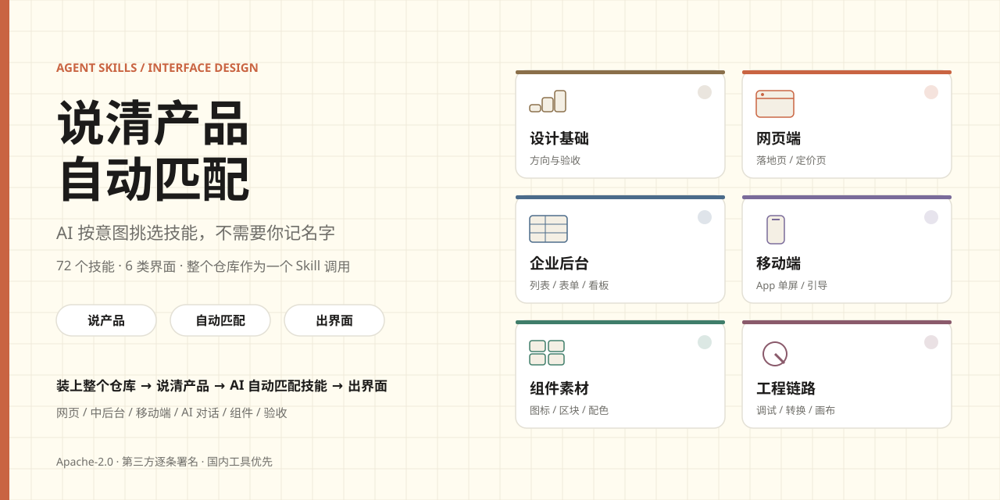
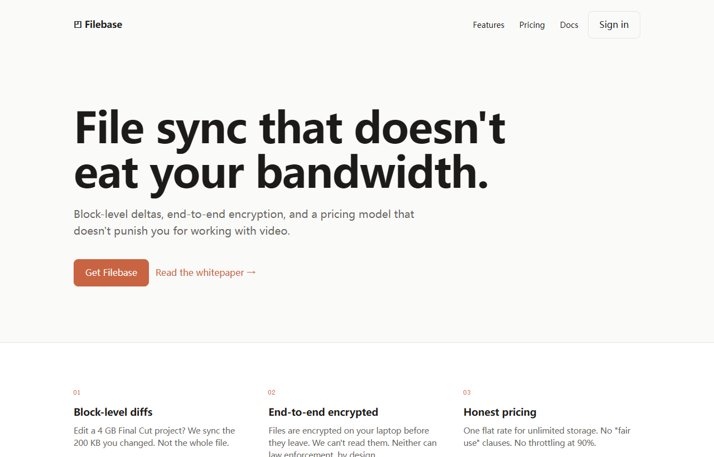
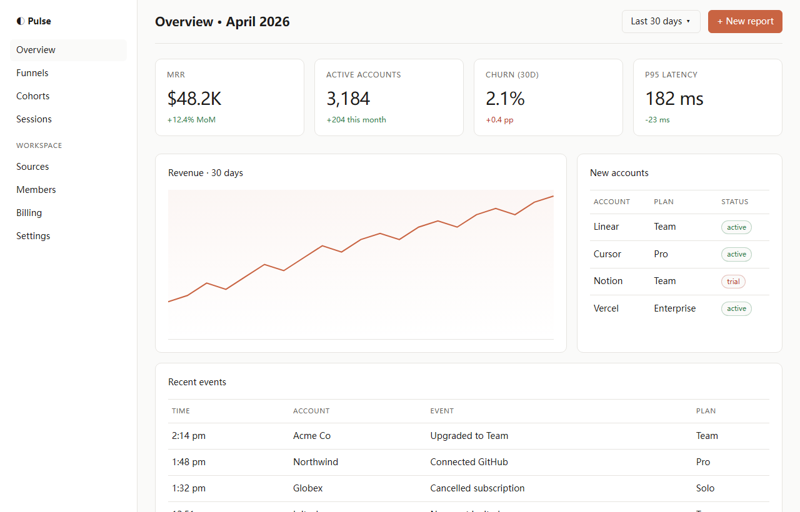
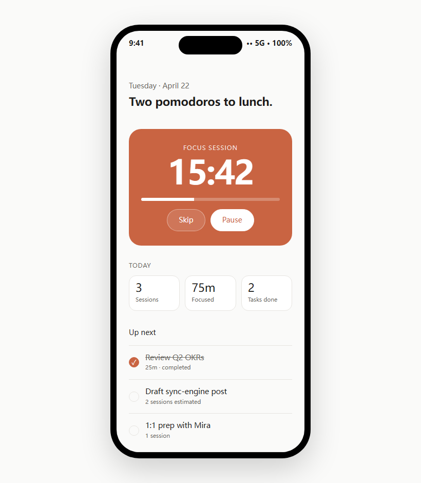
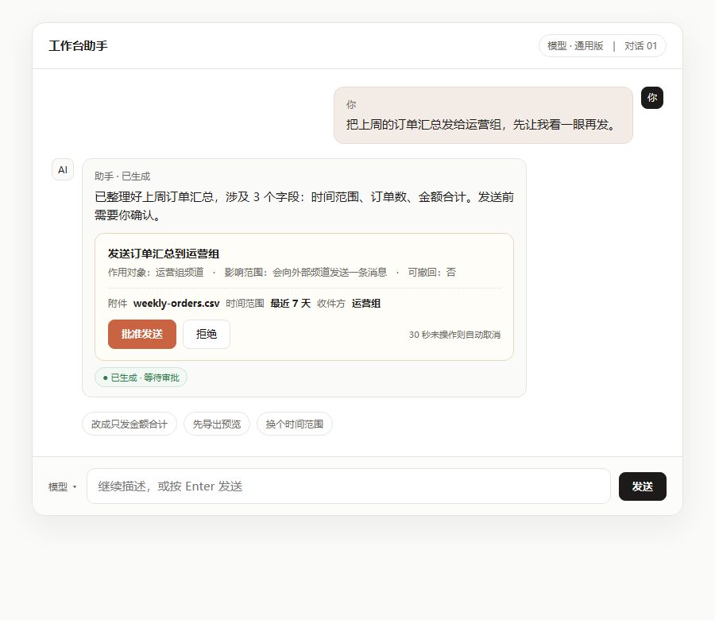
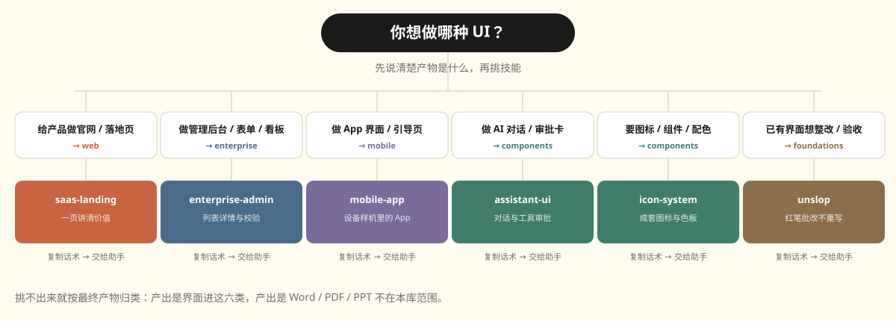
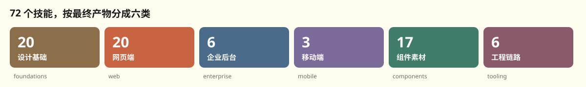
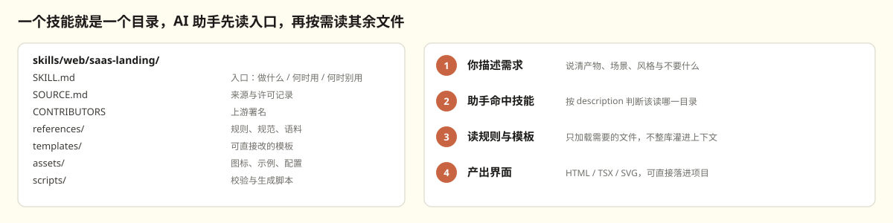

<div align="center">

# UI Design Skills

把一句需求，变成 AI 一次就能做对的界面。67 个技能，每个解决一类界面问题。

</div>



<div align="center">


当前版本 v2.3 · 67 个技能 · Apache-2.0

中文 · [English](./README.en.md) · [贡献其他语言](https://github.com/YardonYan/ui-design-skills/issues)

[看效果](#先看效果) · [30 秒上手](#30-秒上手) · [安装](#安装与支持的助手) · [你想要哪种 UI](#你想要哪种-ui) · [直接抄话术](#话术模板) · [六类](#六类里有什么) · [v2.3 更新](#v23-更新内容) · [常见问题](#常见问题)

</div>

不需要背命令，也不需要记技能名。下面按看到效果、马上上手、挑场景、抄话术、了解全貌的顺序展开，每一段话术都可以整段复制。

## 先看效果

下面四张图都是本库技能的真实产出，用浏览器打开 `assets/demos/` 里对应的 HTML 就能复现，不是示意图。每张图下面配的就是问出它的那句话。

<table>
<tr>
<td width="50%" valign="top">



网页端 · `saas-landing`

> 读 `skills/web/saas-landing/SKILL.md`，按里面的布局给我做一个文件同步产品的官网首页。要顶栏、英雄区、三张特性卡、定价区和 FAQ，桌面 1440 优先，移动端单栏。

</td>
<td width="50%" valign="top">



企业后台 · `dashboard`

> 读 `skills/enterprise/dashboard/SKILL.md`，做一个运营数据看板。左侧固定导航，顶部搜索与通知，下面四张 KPI 卡、一张 30 天趋势折线、一张账户表和最近事件列表。

</td>
</tr>
<tr>
<td width="50%" valign="top">



移动端 · `mobile-app`

> 读 `skills/mobile/mobile-app/SKILL.md`，做一屏专注计时 App 界面，放进 iPhone 15 Pro 设备边框里，要有状态栏、灵动岛、主计时卡、今日统计、待办列表和底部标签栏。

</td>
<td width="50%" valign="top">



AI 对话界面 · `assistant-ui` + `ai-chat-patterns`

> 读 `skills/foundations/ai-chat-patterns/SKILL.md` 列全要处理的状态，再按 `skills/components/assistant-ui/SKILL.md` 做一个对话界面。要有一张工具调用审批卡，写清作用对象、影响范围、是否可逆，批准和拒绝并列，并显示超时行为。

</td>
</tr>
</table>

四张图分别对应网页端、企业后台、移动端和 AI 对话界面。剩下 63 个技能覆盖配色、图标、组件、验收、转换与调试，用法一样：换掉技能路径，说清产物。

## 30 秒上手

看完效果，最短的路径是三步：

1. 拿到仓库。可以 `git clone`，也可以只下载你要用的那一个技能目录。
2. 翻到选型那一节，挑一个最接近的场景，复制它的话术。
3. 把话术发给 AI 助手，助手会自己读 `SKILL.md` 和同目录的 `references/`、`templates/`。

最小可用的一句，替换尖括号里的内容即可：

```
读 skills/<类别>/<技能名>/SKILL.md，按里面的规则做一个 <产物>。
场景：<给谁用、用在什么地方>。风格：<一句话>。必须包含：<三到五项>。
不要：<明确排除的东西>。产出可直接打开的单文件 HTML。
```

不装也能用：把 `SKILL.md` 的正文直接贴进对话，效果一样，只是每次要手动贴。想让助手以后自己读，就往下看安装。

## 安装与支持的助手

零依赖安装器，Node 18 以上即可：

```bash
node tools/install.mjs --list
node tools/install.mjs --skill saas-landing --ai workbuddy
node tools/install.mjs --skill all --ai workbuddy --dry-run
```

一次只装用得到的那个就行，不必全装。安装器会在拷贝前检查每个技能根目录确有 `SKILL.md`，缺一个就整体拒绝。

| 参数 | 作用 |
|---|---|
| `--list` | 列出全部技能与分类 |
| `--skill <名>` / `--skill all` | 选一个技能或全部 |
| `--ai <id>` / `--ai all` | 装到指定助手，或一次装到全部已配置的助手 |
| `--project` | 装到当前项目，而不是用户级目录 |
| `--dir <路径>` | 直接指定目标目录，覆盖默认值 |
| `--dry-run` | 只打印将要复制的内容 |
| `--force` | 目标已存在时覆盖 |
| `--uninstall` | 移除本库装过的技能 |

国内工具排在前面，默认可直接用；国外工具通常需要外网环境。

| 助手 | `--ai` id | 用户级默认目录 |
|---|---|---|
| WorkBuddy | `workbuddy` | `~/.workbuddy/skills/` |
| CodeBuddy | `codebuddy` | `~/.codebuddy/skills/` |
| TRAE 国内版 | `trae-cn` | `~/.trae-cn/skills/` |
| Qoder | `qoder` | `~/.qoder/skills/` |
| Qwen Code | `qwen-code` | `~/.qwen/skills/` |
| OpenClaw | `openclaw` | `~/.openclaw/skills/` |
| Claude Code | `claude` | `~/.claude/skills/` |
| Codex | `codex` | `~/.codex/skills/` |
| Cursor | `cursor` | `~/.cursor/skills/` |

目录是默认值，用 `--dir` 覆盖。也可以把仓库作为插件市场来源，根目录带了四套插件清单：

```bash
claude plugin marketplace add YardonYan/ui-design-skills
```

网页 IDE、云 Shell、在线 Notebook 不适用，它们没有技能加载入口。要一个能跑的界面时，把技能里的模板落到自己的项目里。

## 你想要哪种 UI

装好之后，先别急着写提示词，把产物类型定下来，选错技能比措辞不准更浪费时间。



选不出来就按最终产物归类：产出是界面，进这六类；产出是 Word、PDF、PPT 这类文件，不在本库范围。

| 你大概会这么说 | 用这个技能 | 你会拿到什么 |
|---|---|---|
| 给产品做个官网首页 / 落地页 | `saas-landing` | 含英雄区、特性、社会证明、定价的单页 |
| 做个定价页，三档套餐 | `pricing-page` | 月付年付切换、特性对比表、FAQ |
| 做个 FAQ / 文档站 | `faq-page`、`docs-page` | 问答页与三栏文档页 |
| 做个管理后台，要列表详情编辑页 | `enterprise-admin` | 中后台页面结构与字段定义 |
| 把一堆字段整理成可校验的表单 | `admin-form-schema` | 字段清单、类型、校验规则、示例 JSON |
| 做个数据看板 | `dashboard`、`live-dashboard` | KPI 网格、趋势图、活动流 |
| 做个 App 界面截图 | `mobile-app` | 设备边框里的一屏 App |
| 查 iOS / Android / 小程序尺寸 | `mobile-design-spec` | 五套尺寸规范与安全区数值 |
| 做个 AI 聊天界面 / 审批卡 | `assistant-ui` | 运行时接线、组件、成品界面元素 |
| 列全 AI 对话要处理的状态 | `ai-chat-patterns` | 状态清单与 20 条验收项 |
| 要一整套风格统一的图标 | `icon-system` | 近千个图标定义与命名规范 |
| 要功能插图 / 空状态图 | `spotkit` | 确定性 SVG，亮暗双主题 |
| 要一套读写型界面的配色 | `flexoki-palette` | 色板 CSS 与亮暗映射 |
| 界面一眼 AI 味，想改掉 | `unslop` | 逐条批改意见，不整页重写 |
| 审一下界面的规范与可访问性 | `web-design-guidelines` | 合规问题清单 |
| 从设计图或截图变成代码 | `image-to-code` | 还原后的页面代码 |
| 复刻一个站 | `web-clone` | 逐段还原路径 |
| HTML 转 PDF / 出单文件报告 | `html-to-pdf`、`html-skill-effectiveness` | 可直接交付的文件 |

完整 67 个技能在 `ROUTER.md`（按你会怎么说排）和 `docs/skill-map.md`（按做界面的六段主线排）。

## 话术模板

场景定了，接下来就是怎么把需求说清楚。这一段给不想研究技能细节的人准备，整段复制，只改方括号里的内容。

### 万能公式

```
读 skills/[类别]/[技能名]/SKILL.md，按其中规则做一个 [产物]。
场景：[谁在用、用在哪]。风格：[克制 / 编辑感 / 企业级 / 活泼，选一个]。
必须包含：[三到五项，例如顶栏、英雄区、三张特性卡、定价、FAQ]。
明确不要：[渐变紫、发光、emoji 标签、通栏大写小字距等]。
技术约束：单文件 HTML，无外部依赖，桌面 1440 与移动端都要能看。
完成后列出你做了哪些取舍。
```

### 按场景抄

落地页

```
读 skills/web/saas-landing/SKILL.md，做一个面向开发者的 API 监控产品官网首页。
风格克制，暖纸底，不要紫渐变和发光。要有顶栏、大标题英雄区、双 CTA、
四个特性卡、三步流程、三档定价、FAQ 和页脚。给单文件 HTML。
```

定价页

```
读 skills/web/pricing-page/SKILL.md，做三档定价页。中间档标为推荐，
要有月付年付切换、完整特性对比表、FAQ。价格用占位数字，不要编造真实报价。
```

企业后台

```
读 skills/enterprise/enterprise-admin/SKILL.md，做一个订单管理后台的列表页。
要有筛选区、批量操作、分页、状态标签、行内编辑入口。字段只列我给的这些：
订单号、客户、金额、状态、创建时间。不要自己补字段。
```

表单规则

```
读 skills/enterprise/admin-form-schema/SKILL.md，把这组字段整理成可校验的
Schema：类型、必填、默认值、枚举字典、校验时机、错误提示。给示例 JSON。
资料里没出现的字段一律不要补。
```

移动端

```
读 skills/mobile/mobile-app/SKILL.md，做一屏习惯打卡 App。
放进 iPhone 设备边框，要有状态栏、今日进度、七日热力条、待办列表、底部四个标签。
同时读 skills/mobile/mobile-design-spec/SKILL.md 核对安全区与触控热区。
```

AI 对话界面

```
读 skills/foundations/ai-chat-patterns/SKILL.md 列全状态，再按
skills/components/assistant-ui/SKILL.md 做一个对话界面。
要有流式输出、手动停止、失败重试、追问建议，以及一张工具调用审批卡。
审批卡必须写清作用对象、影响范围、是否可逆，批准与拒绝并列，并显示超时行为。
```

配色

```
读 skills/foundations/flexoki-palette/SKILL.md 和 references/palette.css，
给一个长文阅读型文档站配深浅两套色。正文对比度要够，彩色只做语义点缀，
给 CSS 变量表，不要另写一份色值。
```

图标

```
读 skills/components/icon-system/SKILL.md，给一个文件管理产品做 8 个功能图标：
新建、上传、下载、分享、归档、搜索、删除、设置。线宽、圆角、留白必须一致，
只从一个主色推导颜色，最后导出独立静态 SVG。
```

整改已有界面

```
读 skills/foundations/unslop/SKILL.md，批改我这份 HTML。
不要整页重写，保留结构，先逐条列出 AI 味的证据并标位置，
再按间距、配色、图标、文案、字体、布局的顺序分轮改，每轮只解决一类问题。
```

验收

```
读 skills/foundations/web-design-guidelines/SKILL.md 和
skills/foundations/ai-chat-patterns/references/acceptance-checklist.md，
按清单审这份界面，只出问题清单与位置，不要动手改。
```

### 描述得越准，产出越稳

| 你可能会说 | 建议改成 | 原因 |
|---|---|---|
| 做个好看的页面 | 做个面向开发者的定价页，三档，克制风格，暖纸底 | 好看没有验收标准，产物、档位、风格才有 |
| 做个后台 | 做个订单管理后台列表页，字段只有这五个 | 后台范围太大，不圈字段就会凭空补 |
| 参考某某大厂那样 | 要大字号标题、窄栏正文、细边框、不用渐变 | 直接抄具体产品有版权风险，描述特征更安全 |
| 随便做几个图标 | 做 8 个功能图标，统一线宽与圆角，单一主色 | 数量与不变量决定能不能成套 |
| 再改好看点 | 只改第二屏卡片间距与标题字重，其他不动 | 不说边界，助手容易整页重写 |
| 用你们内部的字段 | 用抽象字段名，真实字段我本地再填 | 外部服务与公开产物不放内部资料 |

### 接着改稿时可以用

```
保留整体结构，只改 [具体区域] 的 [一个属性]，其他一律不动。
```

```
把刚才的取舍逐条列出来，标出哪几条是我没说、你自己补的。
```

```
按 skills/foundations/review-animations/SKILL.md 审动效，只报问题，先别改。
```

```
换成深色底再出一版，色板沿用 skills/foundations/flexoki-palette/references/palette.css。
```

## 六类里有什么

会用之后，回头看一下整个库的全貌，方便按需补技能，而不是每次都从头找。



| 类别 | 管什么 | 技能数 | 代表技能 |
|---|---|---:|---|
| `foundations` | 方向、配色、品牌、交互状态、验收整改 | 15 | `oil-ui`、`flexoki-palette`、`ai-chat-patterns`、`unslop` |
| `web` | 面向公众的网页与页面类型 | 20 | `saas-landing`、`pricing-page`、`web-clone` |
| `enterprise` | 中后台、表单、信息架构、看板 | 6 | `enterprise-admin`、`admin-form-schema` |
| `mobile` | App 界面、引导页、多端尺寸 | 3 | `mobile-app`、`mobile-design-spec` |
| `components` | 组件、区块、图标、插画、图表、AI 对话组件 | 17 | `cult-ui`、`icon-system`、`assistant-ui` |
| `tooling` | 调试、转换、画布格式、交付链路 | 6 | `chrome-devtools`、`html-to-pdf`、`json-canvas` |

## 技能长什么样

知道全貌之后，理解一个技能目录怎么被读取，改起话术和模板会更顺手。



每个技能是一个目录，`SKILL.md` 是入口，YAML frontmatter 里 `name` 与 `description` 必填，`description` 写清做什么、什么时候用、什么时候别用。助手只加载用得到的文件，不会把 67 个技能全灌进上下文。想核对格式可以跑 `python tools/lint_skills.py`。

## v2.3 更新内容

当前版本 v2.3。这一版包含的内容：

| 更新 | 说明 |
|---|---|
| 六类重组 | 67 个技能按最终产物分成 foundations、web、enterprise、mobile、components、tooling，选型不再靠猜 |
| AI 对话界面主线 | 新增 `assistant-ui` 组件载荷与 `ai-chat-patterns` 交互规范，覆盖流式输出、工具审批、分支与可访问性验收 |
| 素材与配色 | 新增成套图标 `icon-system`、动效区块 `ricoui-blocks`、油墨配色 `flexoki-palette` |
| 话术模板库 | 万能公式、10 个场景话术、反面对照与续接话术，全部可直接整段复制 |
| 真实产出与插画 | 四张真实 UI 截图、封面与三张示意图，配零依赖生成脚本 `tools/gen_readme_images.py` 可复现 |
| 工程配套 | 四套插件清单、零依赖安装器与三个校验脚本，格式、敏感词与索引都能一键核对 |
| 对外呈现 | 双语 README 按新访客视角重写，仓库更名 ui-design-skills，About 描述与搜索标签同步优化 |

要看某个技能的具体来源与许可，查 `THIRD-PARTY.md`；要看完整索引，查 `ROUTER.md` 与 `docs/skill-map.md`。

## 常见问题

| 问题 | 回答 |
|---|---|
| 不装能用吗 | 能。把 `SKILL.md` 正文贴进对话即可，装一次只是省掉每次手贴 |
| 要一次装 67 个吗 | 不用。按场景装一个，用到再装下一个 |
| 生成的界面能直接上线吗 | 模板是起点，还要接真实数据、品牌与后端；上线前按 `web-design-guidelines` 审一遍 |
| 改了话术还是跑偏 | 把必须包含与明确不要两项写具体，再补一句：完成后列出你自己补的取舍 |
| 图片里的界面怎么复现 | `assets/demos/` 里有全部源码，`python tools/gen_readme_images.py` 可重新出图 |
| 想要别的风格 | 先用 `oil-ui` 定方向，再让助手按方向稿落地，比直接改页面省一轮返工 |

排错记录见 `docs/troubleshooting.md`，条目都来自实际运行输出。

## 许可

自有内容 Apache-2.0，见 `LICENSE`。第三方内容保留各自许可，逐条列在 `THIRD-PARTY.md`，例外见 `NOTICE`。插画、示意图与截图都在 `assets/`，由 `tools/gen_readme_images.py` 生成，可复现。
